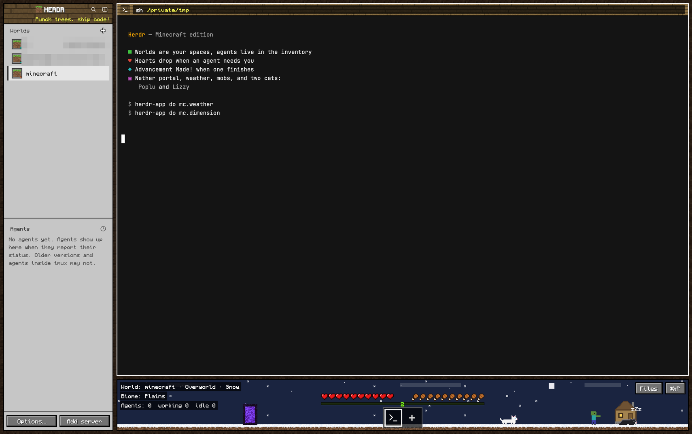

# Herdr, Minecraft edition

A Minecraft-style layout for [Herdr](https://herdr.dev): an inventory sidebar,
oak-plank pane headers, and a living world under your terminals with hearts,
hunger, XP, a hotbar of tabs, weather, a nether portal, a few mobs, and two cats,
Poplu and Lizzy.



## Install

```sh
git clone https://github.com/SwappyB/herdr-minecraft
cd herdr-minecraft
cp layouts/minecraft.json layouts/minecraft.svg ~/.config/herdr-app/layouts/
cp themes/minecraft.json themes/minecraft-light.json ~/.config/herdr-app/themes/
cp -R mods/mc mods/mc-worlds mods/mc-mobs ~/.config/herdr-app/mods/
herdr-app do layout.switch '{"name":"minecraft"}'
```

Check first that you don't already have mods or a layout with these names.
`Ctrl+Shift+L` switches back to your own layout; deleting the copied files removes it.

Or ask your coding agent: *"Add the Herdr layout at github.com/SwappyB/herdr-minecraft"*.
It will follow `RECIPE.md`.

### Optional: Claude usage in the HUD

With a Claude Pro, Max or Ultra plan, the hearts can show how much of your
**5-hour limit** is left and the drumsticks your **weekly limit**. The XP bar
shows the **context window** of the Claude session in the focused pane, and
the level its cost in dollars. Claude Code passes these numbers to status-line
scripts, so a small wrapper saves them for the HUD (to `~/.cache/herdr-mc/`)
and then runs your own status line unchanged.

In `~/.claude/settings.json`, put the wrapper in front of your status line
command (needs `jq` and Claude Code 2.1.251 or later):

```json
"statusLine": { "type": "command", "command": "~/.config/herdr-app/mods/mc/claude-usage.sh <your status line command>" }
```

With no command after it, the wrapper prints nothing, so you get no status
line text, only the HUD. Restart running Claude Code sessions to pick it up.
Without the wrapper, hearts and hunger count agents instead (2 hearts lost per
agent that needs you, 1 drumstick per working agent).

### Optional: Minecraft alert sounds

Herdr's agent sounds are a personal setting, so they aren't changed for you.
To use the level-up chime and creeper hiss everywhere, add to
`~/.config/herdr-app/settings.json`:

```json
"sounds": { "enabled": true, "done": "mods/mc/sounds/levelup.mp3", "blocked": "mods/mc/sounds/hiss.mp3" }
```

## What's in it

- **Inventory sidebar:** spaces as *Worlds* (grass blocks in slots), agents
  with item badges: pickaxe working, creeper needs you, diamond done, torch idle.
- **Pane headers:** oak planks, light when focused.
- **The world** (bottom of the window), with the HUD laid over it:
  - hearts and hunger: your Claude 5-hour and weekly limits left (see above),
    else agents that need you / are working; they shake when low;
  - XP bar: the focused Claude session's context window (green → gold → red),
    level = its cost; else agents finished;
  - hotbar = tabs (click, drag, scroll, right-click);
  - day / night from your system theme (dark mode = night);
  - weather every ~5 min: clear, rain, thunder (the cats run into their hut), snow;
  - a nether portal (click to travel), and a trip to the Nether or the End about once an hour;
  - at most two mobs at a time: chickens, pigs, sheep; zombies and creepers at
    night; piglins and ghasts in the Nether; an enderman in the End.
    Hover for a name, click for a poof.
  - Poplu and Lizzy: hover for their name, click for a meow.
- **"Advancement Made!"** popups when an agent finishes.
- **Light and dark**, following your system: *birch & paper* (warm birch
  sidebar, paper-colored terminal) or *deepslate* (warm dark stone sidebar,
  near-black terminal). The world scene is day or night to match.
- **Fonts:** Monocraft (bundled) for Minecraft labels, Monaspace Krypton for
  lists and panels, Monaspace Neon in terminals. Install Monaspace with
  `brew install --cask font-monaspace` (or from github.com/githubnext/monaspace);
  without it Herdr falls back to JetBrains Mono.

Skip ahead without waiting:

```sh
herdr-app do mc.weather      # next weather
herdr-app do mc.dimension    # Overworld → Nether → End → home
```

Built and tested on Herdr 0.1.12 (macOS). Licenses: see `NOTICE`.
