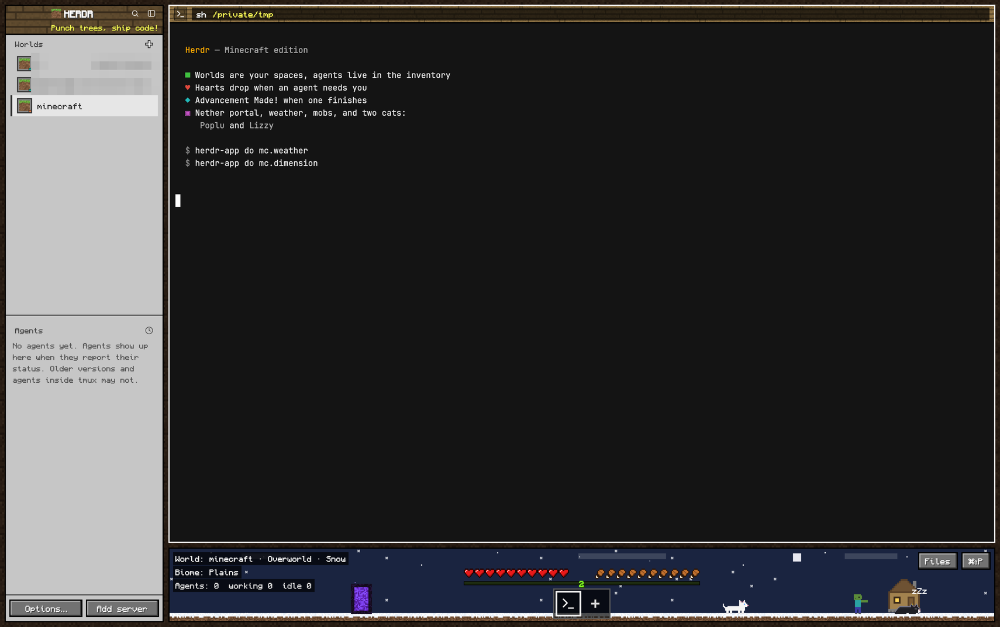

# Herdr, Minecraft edition

Herdr dressed as Minecraft. An inventory panel on the left (birch in light
mode, deepslate in dark) lists
spaces as *Worlds* and agents with item badges. Terminals sit in square,
black-bordered panes under oak-plank headers. The whole window floats on a
dark dirt background. Along the bottom is a living world: sky, ground, a hut,
a nether portal, a few mobs and two cats, Poplu (tuxedo, mostly black) and
Lizzy (white). The game's HUD sits over it: hearts, hunger, XP, and a hotbar
of tabs.

## What you see

Root row, padding 8, gap 8, on `mods/mc/img/dirt-bg.png` (darkened dirt,
cover). Title bar hidden; macOS traffic lights at `[22, 22]`.

- **Sidebar** (272 px, min 44, theme `chrome`, 2 px `#000000` border), top to bottom:
  - *Brand* (50 px, window drag): dark oak plank strip with a grass-block icon
    and a white bold drop-shadowed "HERDR". Search and fold icons are on the
    same row. Under them is a yellow `#ffff55` splash line ("Craft your code!",
    …), picked at random per start, pulsing opacity 0.6↔1. On macOS the left
    padding is 78 so the traffic lights fit.
  - *Worlds* (spaces, weight 1): rows 36 px tall. Each row has a 26 px slot
    (theme `surface`, 2 px theme `input` border) holding a grass block, or
    stone for a remote machine. The space's color is a 6 px square in the
    slot's corner. The selected row is theme `selected` (the terminal's own
    color) with a 3 px `foreground` left edge. Headers in Monocraft.
  - *Agents* (weight 1): program icon in a 24 px slot. Status is shown as an
    item: pickaxe pulsing (working), creeper with "Needs you" on `#3a0d0d`
    (blocked), diamond (done), torch at 75% (idle).
  - *Footer* (46 px): two stone buttons, "Options…" and "Add server"
    (`#77706a` face, 2 px bevel `#aca59c`/`#3e3a35`, 2 px black outline,
    hover `#7f89c4`).
- **Panes:** gap 8, radius 0, background theme `background`, 2 px `#000000` border,
  `#ffffff` when focused. Header 30 px: a strip of oak planks (light when
  focused, dark otherwise) under a 20%/50% black wash. On it: the program in a
  22 px dark slot, then a `#000000b0` strip holding the name (white, shadowed)
  and the folder (yellow when focused, `#e0e0e0` otherwise, no shadow).
  Hovering adds split right, split down, zoom and close buttons.
- **Right panel:** the shipped Files / Changes mods in a `chrome` column with
  a black border.
- **Scene** (128 px, window drag, 2 px black border): one mod draws the world
  behind and the HUD in front.
  - Sky: day `#79a6ff`, night `#0e1636` (stars, moon). Rain `#7d8fa8` / night
    `#0b1226`. Thunder `#56627a` / `#070b18`. Snow `#a9bdd6` / `#1a2440`.
    Nether `#3b0b0b`. End `#0b0712`.
  - Ground: 14 px strip of grass, snow, netherrack or end stone.
  - Hut (72×60) 190 px from the right edge (Overworld). Its window is lit at
    night or while a cat is inside.
  - Nether portal (36×52) at 22% of the width, in the Overworld and the
    Nether. In the End, a 64×12 bedrock exit portal sits there instead.
  - F3 lines top left: white text on `#000000b0` reading "World: <space> ·
    <dimension> · <weather>", "Biome: <branch or Plains>", and "Agents: n
    working n idle n". A red line is added when an agent needs you.
  - Top right: Files, Changes and palette buttons.
  - Bottom center (404 px wide): the held tab's name (fades after 2.2 s); 10
    hearts and 10 drumsticks (18 px); a 7 px XP bar `#80ff20` with the level
    in green; the hotbar of 44 px slots on `#000000b0` with a `#5a5a5a`
    border. The active slot has a 3 px `#f0f0f0` frame. Each slot shows the
    tab's program icon, its pane count, and its status (pickaxe, diamond, TNT;
    a red slot when blocked). A "+" slot comes last.
- **Fonts:** ui_font Monaspace Krypton, terminals Monaspace Neon 14; Monocraft
  (bundled in `mods/mc/fonts/`) set explicitly on Minecraft labels (drop-shadow
  text, buttons, HUD, scene, section headers).
- **Themes**, `"theme": {"light": "minecraft-light", "dark": "minecraft"}`:
  - *birch & paper* (light): terminal `#f6f1e4` / `#2f2a22`, chrome `#e2d7bd`,
    surface (slots) `#cbb990`, input `#7a6646`, selected `#f6f1e4`, dim `#665843`.
  - *deepslate* (dark): terminal `#1a1917` / `#e8e2d6`, chrome `#2a2826`,
    surface `#1c1a18`, input `#0e0d0c`, selected `#3a3631`, dim `#ada494`.
  - Both keep Minecraft chat colors for ANSI, darkened on light to pass 4.5:1.
  - Stone buttons are warm gray `#77706a` (bevel `#aca59c` / `#3e3a35`).

## How it behaves

- **Claude usage** (when `~/.cache/herdr-mc/claude-usage.json` exists, written
  by `mods/mc/claude-usage.sh` running as Claude Code's status line):
  - Hearts = 5-hour limit left, drumsticks = weekly limit left, one half icon
    per 5%. A window whose `resets_at` has passed counts as full. At 4 halves
    or fewer the row shakes (`loop("top")`). Hover: percent left, reset time,
    and how long ago Claude Code last reported. Read every 30 s.
  - XP bar: if the focused pane runs Claude Code, its
    `~/.cache/herdr-mc/sessions/<terminal>.json` (keyed by `HC_TERMINAL_ID`):
    width = `context_window.used_percentage`, green `#80ff20`, gold `#ffcc33`
    from 70%, red `#ff5555` pulsing from 90%; level = floor of
    `cost.total_cost_usd`, drawn in the bar's color. Read every 10 s and on
    focus change. Hover: context %, tokens of window size, model, session cost.
  - Without these files the agent-based behavior below applies.
- **Agent status:**
  - working: pickaxe on the slot, row and pane header; one drumstick eaten
    per working agent.
  - blocked: creeper "Needs you!" in the pane header; a red hotbar slot with
    blinking TNT; 2 hearts lost per blocked agent and the hearts flash; a red
    "!" over the cats; a "Creeper? Aw man!" popup.
  - done (finished while you weren't looking): a diamond; an "Advancement
    Made!" popup, +1 level, and hearts over both cats.
  - idle: a torch. Finishing while you look counts too (working→idle plays
    `xp.mp3`).
  - The XP bar shows the share of agents that are idle or done.
- **Hotbar:** click selects (plays a click), double-click renames, right-click
  opens the tab menu, drag reorders, the scroll wheel cycles tabs, "+" opens
  the new-tab menu. Files / Changes remember their state per space.
- **Popups** (a floating block at the panes' top right) last 5 s, keep at
  most 3, and clicking one focuses that agent.
- **World clock:**
  - Night while the system is in dark mode.
  - Weather rerolls every 4–6 min: clear 45%, rain 25%, thunder 15%, snow 15%.
  - Every 50–70 min there's a 5-minute trip to the Nether or the End. For the
    Nether, the cats first walk into the portal. Each switch shows a 0.7 s
    purple flash.
  - Clicking a portal travels right away.
  - State survives reloads (localStorage).
- **Cats:** each decides every few seconds to walk (38 px/s), sit or nap
  ("zZz"). They nap more at night or in rain or snow, sometimes go into the
  hut at night, and always go in during thunder. Hover shows a name tag;
  click plays a meow and shows hearts. Poplu gets a gray outline on dark skies.
- **Mobs:** at most 2. Every 15 s there's a 50% chance one spawns, and it
  stays 60–120 s, fading in and out.
  - Overworld day: chicken, pig, sheep. Night or thunder: zombie, creeper.
    Mobs leave when they no longer fit (morning comes, the storm ends).
  - Nether: zombified piglin, ghast (floats, bobbing).
  - End: enderman (teleports 25% of the time).
  - Creepers move away from any cat within 120 px.
  - Hover shows the mob's name; click poofs it and plays `xp.mp3`. A
    dimension change clears all mobs.
- **Commands:** `mc.weather` (next weather) and `mc.dimension` (portal trip
  to the next dimension), through keys.json or `herdr-app do`.

## Built from

- `layouts/minecraft.json`, a root row:
  - `sidebar` column with blocks `brand` (mc {role: brand}), `spaces`
    (mc-worlds), `agents` (mc-mobs) and `sidebar-footer` (mc {role: footer}).
  - `work` column with the `work-body` row and the `hud` block
    (mc {role: scene}). `work-body` holds `main` (tab "active", pane header
    mc {role: pane}) and the hidden `panel` stack (files, changes).
  - `work` floats `advancement` (mc {role: advancement}, top end).
- `mods/mc/`: `main.js` (roles), `kit.js` (colors, bevels, drop-shadow text,
  stone buttons, texture strips), `chrome.js` (brand, footer), `pane.js`,
  `hud.js`, `pets.js` (world, weather, portals, cats), `mobs.js`,
  `advancement.js`.
  - Art comes from `art/generate.py` (Pillow). Every icon is an SVG of
    crisp-edged rects; the background is a nearest-neighbour PNG.
  - Sounds were made with ffmpeg: click, xp, levelup, hiss, two meows.
- `mods/mc-worlds`, `mods/mc-mobs`: `mod.clone` of the shipped `spaces` and
  `agents` (Herdr 0.1.12), restyled (rows, slots, item badges, labels).
- Herdr APIs used: `spaces`, `panes`, `agents`, `settings().dark`,
  `shared`/`setShared` (`mc.level`), `layout`, `keys`, `window`,
  `openOverlay` (menu, new-menu), `playSound`, `nextCommand`, and `run` with
  `tab.*`, `pane.*`, `layout.show/hide/select/resize`, `app.palette`,
  `app.settings`, `mod.open`.
- Programs: none run by the mod. No network access. It reads
  `~/.cache/herdr-mc/` (written by `claude-usage.sh`, an optional status-line
  wrapper that uses `jq`) and nothing else outside `~/.config/herdr-app`.

## Watch out

- `herdr-app shot` returns the last drawn frame; while the window is hidden
  it's stale. Bring the window forward before judging a screenshot.
- Herdr draws a light frame (the theme's popover) around floating mods, so the
  popup card paints its own `#212121` background, and its stack has a black
  background between cards.
- `.loop()` swings there and back, so it can't make things fall. Rain, snow,
  ash and End particles are `.frames()` of precomputed multi-line text where
  each drop moves one row per frame.
- Leg swaps use `opacity` loops from −3 to 4 (linear); values outside 0..1
  clamp, which turns a crossfade into a snap.
- Walking is `.left(x).transition("left", {duration})` set once per
  decision. Keep each element's id stable, and use a per-cat/per-mob
  generation counter so a new decision (a storm) cancels pending timers.
- Small text gets no drop shadow (it blurs). Monocraft in terminals was hard
  to read, which is why terminals use JetBrains Mono.
- Day/night follows `settings().dark`, not the clock.
- Plan usage has no documented API; the status line JSON (`rate_limits`,
  `context_window`, `cost`) is the only source, so numbers are only as fresh as
  the last Claude Code activity. Sessions started before the wrapper was set
  keep the old status line until restarted.
- Sidebar mods use theme colors (no hardcoded grays), so one pair of theme
  files restyles both modes. Programs in terminals still choose their own colors.
- The alert sounds in `settings.json` are the person's setting; the layout
  doesn't change them (see README).
- Mod clones carry `cloned_from`; Herdr updates don't touch them.

## Done when

- `herdr-app check` passes for `mods/mc`, `mods/mc-worlds` and `mods/mc-mobs`,
  and `herdr-app status` shows no errors after `layout.switch minecraft`.
- The sidebar shows Worlds with grass-block slots and the Agents list, and the
  splash line doesn't overlap the icons.
- A terminal that reports OSC 7501 `state=blocked` costs 2 hearts, turns its
  hotbar slot red and raises a "Creeper? Aw man!" popup. `state=done` shows
  "Advancement Made!" and adds 1 to `mc.level` in `shared.json`.
- `herdr-app do mc.weather` cycles rain → thunder (both cats enter the hut
  within seconds) → snow (white ground) → clear.
- `herdr-app do mc.dimension` walks the cats into the portal and arrives in
  the Nether (ghast, lava, glowstone); again goes to the End (pillars, exit
  portal); again comes home.
- Within a minute, one or two mobs fit for the dimension and time appear and
  later fade out.
